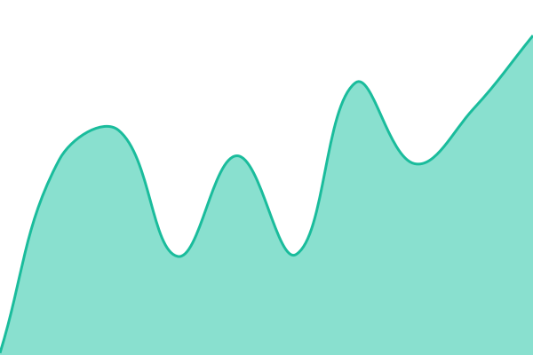

# Morsel status

Uptime monitoring and the public status page for [Morsel](https://projectmorsel.web.app),
run by [Upptime](https://upptime.js.org), an open-source monitor powered by GitHub Actions,
Issues and Pages.

- What's checked and how often: [`.upptimerc.yml`](.upptimerc.yml).
- When something is down, an issue opens here and closes when it's back. Those issues are
  the incident record.
- Morsel's web app reads `history/summary.json` for the uptime on its own status page.

## [Live status](https://status.projectmorsel.com): <!--live status--> **🟩 All systems operational**

<!--start: status pages-->
<!-- This summary is generated by Upptime (https://github.com/upptime/upptime) -->
<!-- Do not edit this manually, your changes will be overwritten -->
<!-- prettier-ignore -->
| URL | Status | History | Response Time | Uptime |
| --- | ------ | ------- | ------------- | ------ |
|  [Morsel service](https://morsel-dev-api-1087699136488.us-east1.run.app/v1/status) | 🟩 Up | [morsel-service.yml](https://github.com/Project-Morsel/morsel-status/commits/HEAD/history/morsel-service.yml) | 

 182ms
     
 | 

<a href="https://Project-Morsel.github.io/morsel-status/history/morsel-service">100.00%</a>
    

|  [Assistant connection (MCP)](https://morsel-dev-api-1087699136488.us-east1.run.app/mcp) | 🟩 Up | [assistant-connection-mcp.yml](https://github.com/Project-Morsel/morsel-status/commits/HEAD/history/assistant-connection-mcp.yml) | 

 107ms
     
 | 

<a href="https://Project-Morsel.github.io/morsel-status/history/assistant-connection-mcp">100.00%</a>
    

|  [Web app](https://morsel-dev-web-1087699136488.us-east1.run.app/) | 🟩 Up | [web-app.yml](https://github.com/Project-Morsel/morsel-status/commits/HEAD/history/web-app.yml) | 

 1533ms
     
 | 

<a href="https://Project-Morsel.github.io/morsel-status/history/web-app">100.00%</a>
    

|  [Website](https://projectmorsel.web.app/) | 🟩 Up | [website.yml](https://github.com/Project-Morsel/morsel-status/commits/HEAD/history/website.yml) | 

 143ms
     
 | 

<a href="https://Project-Morsel.github.io/morsel-status/history/website">100.00%</a>
    

<!--end: status pages-->

The workflows in `.github/workflows` come from the Upptime template and are updated by it;
change `.upptimerc.yml`, not the workflows. The Upptime code is MIT licensed (`LICENSE`).
